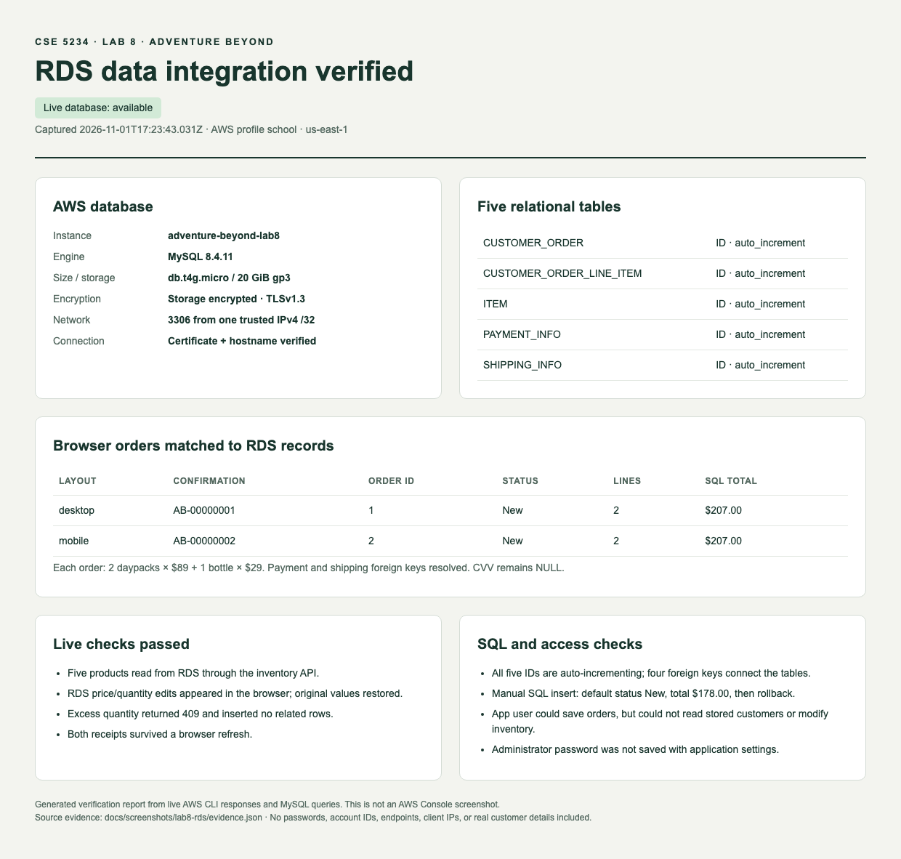
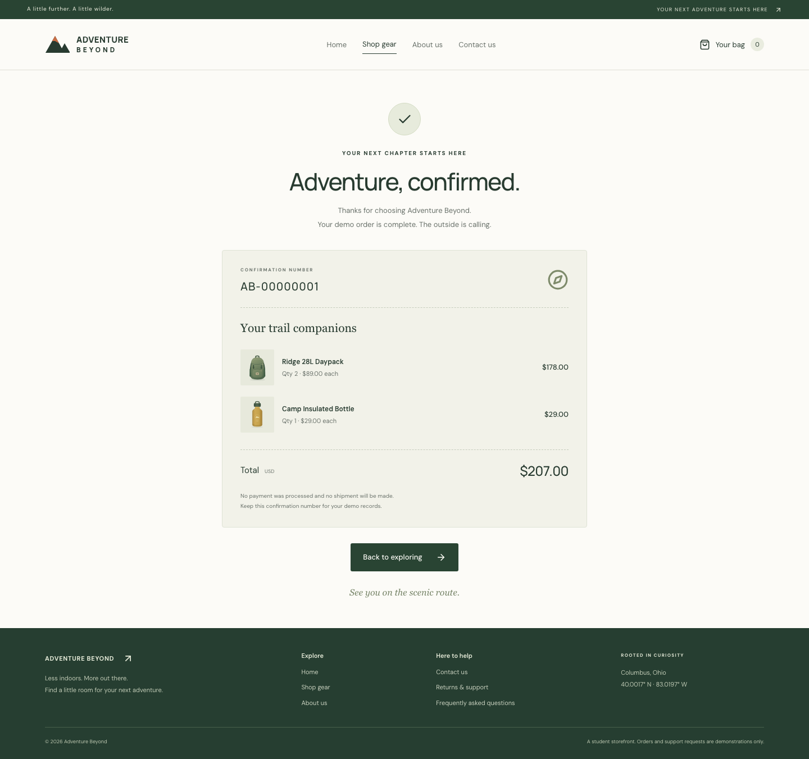

# Lab 8 verification

Verified on **November 1, 2026**, first with local MySQL and then with a live Amazon RDS MySQL database.

## Live RDS verification

CloudFormation stack `adventure-beyond-lab8-rds` reached `CREATE_COMPLETE`. RDS instance `adventure-beyond-lab8` was `available` in the `school` account, region `us-east-1`: MySQL 8.4.11, `db.t4g.micro`, Single-AZ, and 20 GiB encrypted gp3 storage. The website and both services ran locally and connected to RDS. No Lambda/API Gateway deployment is claimed.

| Live check | Result |
| --- | --- |
| Connection and network | TLS 1.3; certificate and hostname verified; MySQL requires secure transport; port 3306 allowed from one IPv4 `/32` |
| Schema | All five tables present; all IDs auto-increment; four foreign-key relationships verified |
| Initial inventory | Five products read from RDS through the API |
| Live inventory edit | Bottle changed to $31.29 / quantity 3; API and browser showed the change; original $29.00 / quantity 30 restored |
| Application permissions | Item reads and complete order inserts succeeded; reading stored orders and modifying inventory were denied |
| Excess quantity | 13 daypacks returned `409 INSUFFICIENT_STOCK`; none of the four order-related tables gained rows |
| Desktop checkout | Saved RDS order 1, `AB-00000001`, `New`, two item lines, total `$207.00` |
| Phone checkout | Saved RDS order 2, `AB-00000002`, `New`, two item lines, total `$207.00` |
| Saved relationships | Both orders joined to their shipping/payment records; masked card `****4242`, CVV `NULL` |
| Browser refresh | Both confirmations remained visible |
| Manual SQL example | Inserted related records with default `New` and total `$178.00`, then rolled back; saved order counts unchanged |
| Initialization | Repeated `rds:setup` preserved existing data and reused the restricted application credentials |
| Deployment template | `infra/rds-local-access.yaml` passed cfn-lint and AWS template validation before actual deployment |

Cloud evidence is in its own folder, separate from the earlier local screenshots:

- [Desktop shipping form](screenshots/lab8-rds/desktop-shipping.png) and [desktop confirmation](screenshots/lab8-rds/desktop-confirmation.png)
- [Phone shipping form](screenshots/lab8-rds/mobile-shipping.png) and [phone confirmation](screenshots/lab8-rds/mobile-confirmation.png)
- [Sanitized AWS/SQL evidence JSON](screenshots/lab8-rds/evidence.json)
- [Manual SQL query output](screenshots/lab8-rds/manual-query.txt)
- [RDS verification report image](screenshots/lab8-rds/rds-verification.png), generated from the live AWS API and SQL results; **this is not an AWS Console screenshot**

For another demonstration, follow [RDS-LOCAL.md](RDS-LOCAL.md), use `npm run dev:rds`, and inspect saved records with `npm run rds:inspect`. The AWS login is needed for administration commands; the normal app uses its private `.env.rds`. Cloud resources continue to exist after the local app stops; see the guide's cost and cleanup instructions.

## Local automated checks

These checks used the separate local MySQL 8.4 Docker database. They do not run destructive test fixtures against RDS.

| Check | Result |
| --- | --- |
| `npm ci` | Website and service dependencies installed from lockfiles |
| `npm test` | 27 passed: 12 unit tests and 15 API/database tests |
| `npm run test:e2e` | 40 passed across desktop and phone layouts; production build passed |
| `npm run db:init` twice | Five seeded products; existing edits and orders preserved |
| `database/003-manual-check.sql` | Related records inserted, status defaulted to New, then rolled back |
| `npm run db:inspect` before/after database restart | Both screenshot orders remained, with matching totals |
| Documented restricted application database grants | Inventory read and complete order insert succeeded |
| TLS with an untrusted local certificate | Connection rejected |
| `cfn-lint template.yaml infra/rds.yaml` | Passed without warnings or errors; these alternative private-RDS/Lambda templates were not deployed |

The API tests use a real, separate MySQL database. They verify live SQL changes, exact saved prices, foreign-key relationships, quantity validation, missing stock, database failures, and complete rollback after a simulated failure on the second line insert. Browser tests query their newly saved order in SQL and match its displayed confirmation and total.

## Earlier local screenshot orders

Both orders contain two daypacks and one bottle. These are demonstration records in the development database, separate from automated test orders. Their related shipping and payment records were queried directly, and the same order records were present after restarting MySQL.

The local and RDS databases independently started their IDs at 1, so their confirmation numbers happen to match. The folders and SQL timestamps distinguish the local and cloud evidence.

| Screenshot | Saved order ID | Confirmation | Status | Item lines | Total |
| --- | --- | --- | --- | --- | --- |
| Desktop | 1 | AB-00000001 | New | 2 | $207.00 |
| Phone | 2 | AB-00000002 | New | 2 | $207.00 |

Full screenshots:

- [Desktop shipping form with email](screenshots/lab8/desktop-shipping.png)
- [Desktop confirmation](screenshots/lab8/desktop-confirmation.png)
- [Phone shipping form with email](screenshots/lab8/mobile-shipping.png)
- [Phone confirmation](screenshots/lab8/mobile-confirmation.png)

## Limits

Stock is checked without being decremented. Payment is a demo: the database stores a masked number and no CVV. There is no durable idempotency key, so retrying after a lost success response may create another order. The private-RDS/Lambda alternative remains untested in AWS. RDS availability and the permitted client IP must be checked before a future demonstration.
