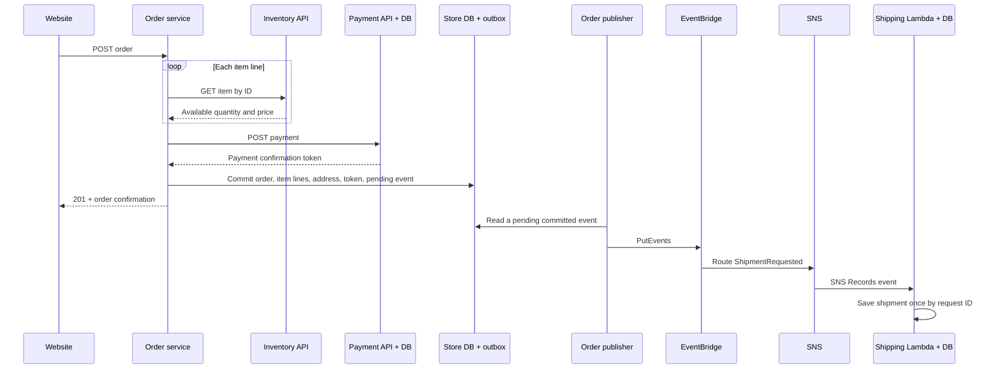

# Lab 9: services integration

Lab 9 has two ideas: **wait for an answer when it is needed now** (inventory and payment), and **send a message for work that can happen later** (shipping).

The local implementation is working. The AWS configuration is implemented and statically checked, but **live Lab 9 AWS deployment and verification are pending renewed school-account login**. This document does not claim that EventBridge/SNS are already running.

## Requirement checklist

| Handout requirement | Implementation |
| --- | --- |
| Check each item through inventory's item-by-ID API | Order calls `/inventory-management/inventory/items/{id}` once per distinct product line |
| Independent `POST /payment` service and database | Separate process/Lambda, `adventure_payment.PAYMENT_INFO`, and restricted payment user |
| Pay after stock validation | Order checks the inventory response and current stock before calling payment |
| Store a payment token instead of order card details | New orders have `PAYMENT_CONFIRMATION_TOKEN`; the old payment foreign key is `NULL` |
| Independent `POST /shipping` service and database | Separate process/Lambda, `adventure_shipping.SHIPMENT`, and restricted shipping user |
| Business ID, address, packet count, and each packet's weight | `businessId`, `address`, `packetCount`, `packetWeightsPounds` |
| One packet per item line | 2 daypacks and 1 bottle produce 2 packets |
| Send shipping after successful order persistence | Order and pending message commit atomically; a separate publisher reads committed messages |
| AWS EventBridge and SNS, no direct order-to-shipping call | Custom event bus → matching rule → SNS topic → shipping Lambda |
| Rules, event pattern, targets, and invocation permissions | `infra/lab9.yaml`: scoped publish role, SNS subscription, Lambda invocation permission, and failure queue |

The handout permits a fixed weight per unit. Its suggested 1 lb/unit conflicts with its example of 10 units weighing 20 lb. This implementation explicitly chooses **1 lb/unit**: `[2 daypacks, 1 bottle]` produces weights `[2, 1]` lb. Change `ITEM_WEIGHT_POUNDS` in `services/orders/shipment.js` if the instructor chooses a different assumption.

The handout does not specify a submission filename, deadline, or screenshot count. Check the course submission page for those details.

## How a checkout travels



Payment and shipping have separate database users and no access to each other's tables or the storefront. The classroom configuration shares **one physical MySQL/RDS instance with three logical databases** to avoid two extra instances. It is not separate bank-owned infrastructure. Database hosts are configurable, and the partner template accepts separate hosts for an environment that requires physical separation.

Local startup creates four HTTP services and two background workers. It simulates topic delivery with files under ignored `.local-events/shipment-requested/`. The shipping process consumes the same EventBridge payload inside an SNS-shaped envelope. Local files are **not AWS EventBridge/SNS**.

## Run locally and demonstrate

From the repository root, with Docker running:

```sh
npm ci
npm run db:up
npm run db:init
npm run dev
```

Open `http://127.0.0.1:5173/purchase`. Buy 2 daypacks and 1 bottle using the README's fictional customer details. The receipt should be $207. In another terminal:

```sh
npm run lab9:inspect
npm run lab9:capture
```

Inspection prints no customer names, addresses, card numbers, or credentials. Match the order's payment token to a payment row; match its event ID to a shipment request ID. `lab9:capture` places **two additional demo orders**, checks their saved records, replays their messages, and saves desktop/mobile screenshots plus sanitized JSON under `docs/screenshots/lab9/`.

`npm run db:init` is repeatable. It keeps Lab 8 orders and masked payment records, makes the old payment foreign key optional, and adds the token/outbox columns and partner tables. It uses Docker's root user only to create local partner databases and users; running services receive their own credentials.

## Deploy the Lab 9 partners in AWS

This deployment uses:

- Existing `adventure-beyond-lab8-rds` stack / `adventure-beyond-lab8` RDS instance in `us-east-1`.
- Two Lambda functions and two API Gateway HTTP APIs for payment and shipping.
- One custom EventBridge bus and one rule, one SNS topic/subscription, IAM permissions, and an SQS failure queue.
- One private S3 bucket for Lambda deployment packages and log groups with seven-day retention.
- The local website, inventory/order services, and publishing worker. Keep `dev:aws` running for pending orders to be published.

It creates **no additional RDS instance, EC2 instance, VPC, or NAT gateway**. The partner Lambdas only need MySQL access inside the existing VPC. API Gateway invokes them, and SNS invokes shipping. The local publisher reaches EventBridge over the laptop's internet connection.

Use the authorized `school` profile, account `358148451783`. The deployment script refuses another profile/account.

1. Sign in and check the database:

   ```sh
   aws sso login --profile school
   aws sts get-caller-identity --profile school --region us-east-1
   aws rds describe-db-instances --db-instance-identifier adventure-beyond-lab8 --profile school --region us-east-1 --query 'DBInstances[0].DBInstanceStatus' --output text
   ```

2. If its status is `stopped`, start the existing instance and wait for `available`:

   ```sh
   aws rds start-db-instance --db-instance-identifier adventure-beyond-lab8 --profile school --region us-east-1 --query 'DBInstance.DBInstanceStatus' --output text
   ```

3. Confirm the RDS security group's `ClientCidr` is your current public IPv4 followed by `/32`. If your IP changed, update **only** that parameter in the existing RDS CloudFormation stack, preserving its other parameters. Do not broaden the CIDR. The Lab 9 stack adds a separate security-group rule for the partner Lambdas.
4. From the repo root:

   ```sh
   npm run lab9:setup
   npm run lab9:deploy
   ```

   Setup reads the RDS-managed administrator secret into memory, migrates the store, and provisions payment/shipping users with only `SELECT, INSERT` on their own table. It saves private settings to ignored `.env.lab9`. The order user gets pending-message read/write access and loses insert access to the legacy card table. No data is deleted.

   Deployment first creates `adventure-beyond-lab9-artifacts`, packages the locked backend dependencies, and creates/updates `adventure-beyond-lab9`. Database passwords go through a temporary file with owner-only permissions, never shell arguments or logs. That file is removed after the request. This workflow uses AWS CLI and **does not require SAM CLI**.

5. Stop the local `npm run dev`, then run:

   ```sh
   npm run dev:aws
   ```

   The startup command reads the deployed payment URL and EventBridge bus name. It starts the local store and publisher, without starting local payment/shipping servers. AWS credentials stay in the school SSO session. If SSO expires, publishing leaves the message pending for retry.

6. Verify the cloud path:

   ```sh
   npm run lab9:inspect:aws
   npm run lab9:capture:aws
   ```

   Cloud capture saves evidence under `docs/screenshots/lab9-aws/` only after it matches the browser order to the remote payment and shipment records. Also capture the EventBridge rule's pattern/target, SNS subscription, shipping Lambda invocation, and database/query results from AWS. Do not include `.env` files, secrets, or real customer data.

7. Read the `ShippingFunctionName`, `ShippingTopicArn`, `ShippingRuleArn`, and `DeliveryFailuresUrl` outputs from the Lab 9 stack. Confirm the rule is enabled, SNS subscription is confirmed, and the failure queue is empty. Inspect Lambda errors if a message is published but no shipment appears.

The cloud endpoints are unauthenticated classroom APIs with throttling, not production payment/carrier APIs. The script prepares the shared-instance setup; separately hosted partner databases require provisioning their users on their own hosts before supplying those hosts to the template.

## Failure behavior

| Failure | Result |
| --- | --- |
| Invalid fields or insufficient stock | No payment, order, or shipping event |
| Payment unavailable or returns an invalid token | No order or shipping event |
| Order transaction fails after payment | No order/outbox rows; the independent demo payment can remain |
| Publisher fails or SSO expires | Confirmed order remains; pending event retries after 30 seconds |
| Process stops after publish but before marking sent | Event may be sent again; shipping deduplicates by request ID |
| Same shipment request ID with different content | Shipping rejects with `409 SHIPMENT_CONFLICT` |
| Shipping database unavailable | SNS Lambda handler throws so AWS retries; exhausted delivery goes to the failure queue |
| Malformed local message | It stays in the local queue for inspection/retry; other messages can still be processed |

`PUBLISHED_AT` means the event transport accepted the message; it does **not** prove the shipment was saved. Verify the matching row in the shipping database. AWS delivery can repeat messages, so the unique `REQUEST_ID` and payload hash matter. Whole-order retries, refunds, inventory reservation, and a production distributed transaction are not implemented.

## Permissions and optional fully hosted store

The EventBridge target role can publish only to the shipping topic. SNS has permission to invoke only its shipping Lambda subscription. The failure queue accepts messages from the configured rule/topic and the shipping Lambda's role. No event body is logged by application code.

For the local AWS publisher, the required event permissions are `events:DescribeEventBus` and `events:PutEvents` on the output bus ARN. The school's current role may have broader permissions; the app does not embed AWS access keys.

The root `template.yaml` is a separate option for AWS-hosted inventory/order plus a scheduled outbox publisher. Deploy the partner stack first, then supply its payment URL and event bus name. That option requires private-subnet internet egress for HTTPS calls; it is **not** created by `lab9:deploy`. See [AWS.md](AWS.md).

## Stop and cleanup

After the demonstration, wait until pending messages are delivered and verify shipments before stopping the app. Stopping the app does not stop RDS. To pause the existing database:

```sh
aws rds stop-db-instance --db-instance-identifier adventure-beyond-lab8 --profile school --region us-east-1 --query 'DBInstance.DBInstanceStatus' --output text
```

While RDS is stopped, the APIs cannot save payments/shipments. Retained storage/secrets still have costs, and RDS automatically restarts after a maximum of seven days. Check the database before each demo; no stopping or cleanup is automatic.

When the group no longer needs Lab 9, delete only `adventure-beyond-lab9` to remove its partner APIs, functions, bus, topic, queue, logs, and added security-group rule. The existing RDS database and all three logical databases remain. Delete the artifact stack separately; its bucket is retained and build objects expire after 30 days. Empty/delete that specific bucket separately when no deployment needs it. Do not delete the Lab 8 stack or database data without the group's agreement.

## References

- [EventBridge target permissions](https://docs.aws.amazon.com/eventbridge/latest/userguide/eb-use-resource-based.html)
- [Using Lambda with SNS](https://docs.aws.amazon.com/lambda/latest/dg/with-sns.html)
- [EventBridge PutEvents results and nonexistent buses](https://docs.aws.amazon.com/eventbridge/latest/userguide/eb-putevents.html)
- [Transactional outbox pattern](https://docs.aws.amazon.com/prescriptive-guidance/latest/cloud-design-patterns/transactional-outbox.html)
- [Stopping an RDS instance](https://docs.aws.amazon.com/AmazonRDS/latest/UserGuide/USER_StopInstance.html)
